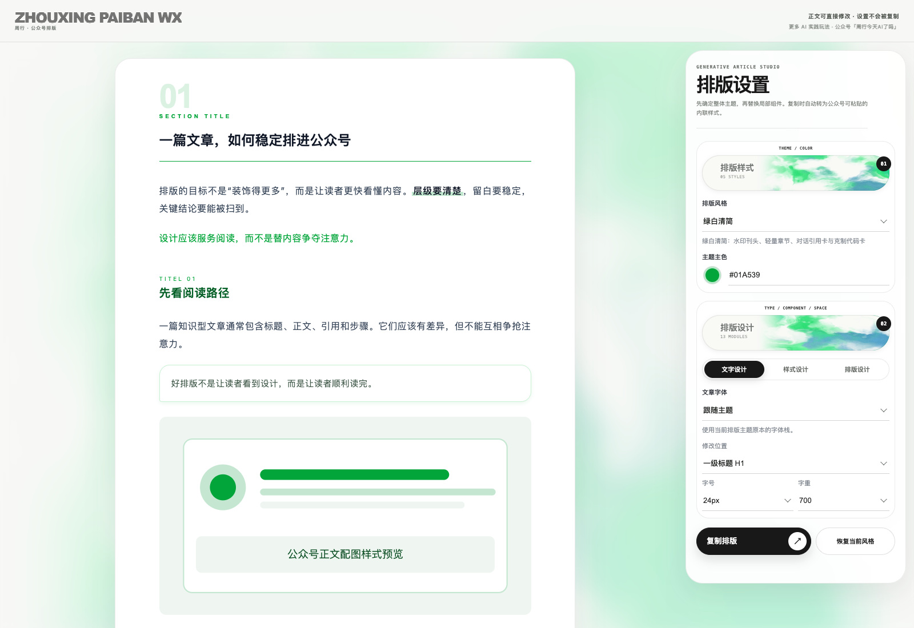
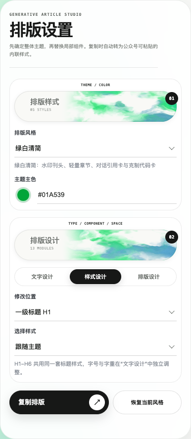
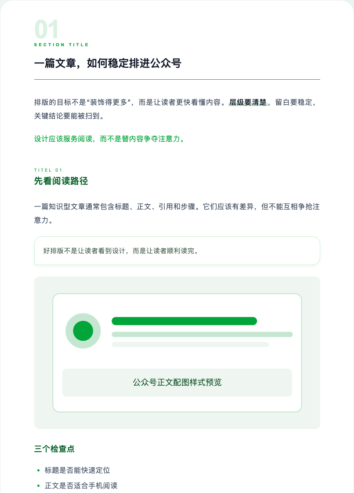
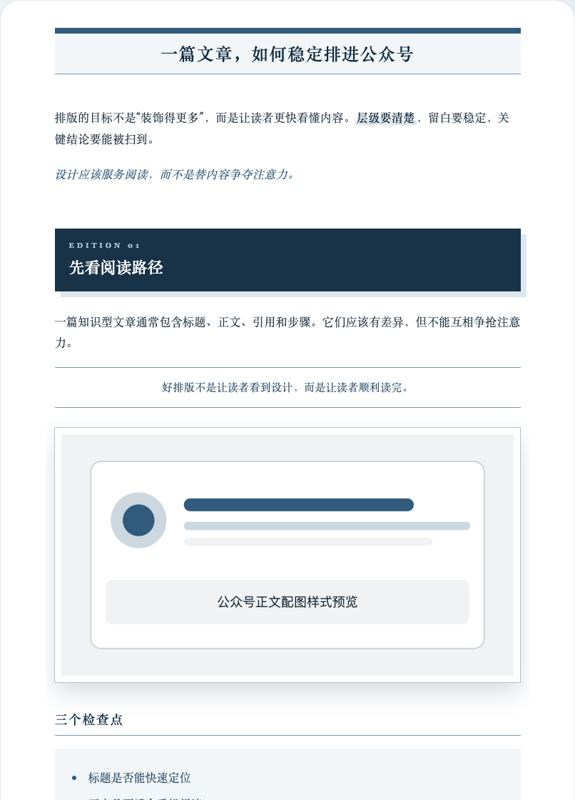
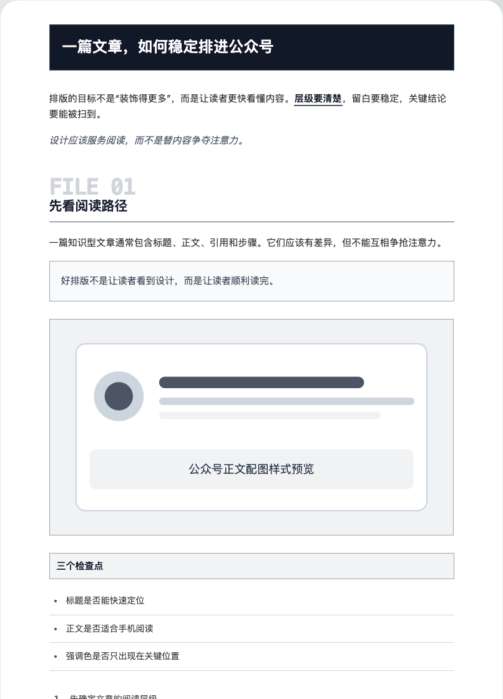
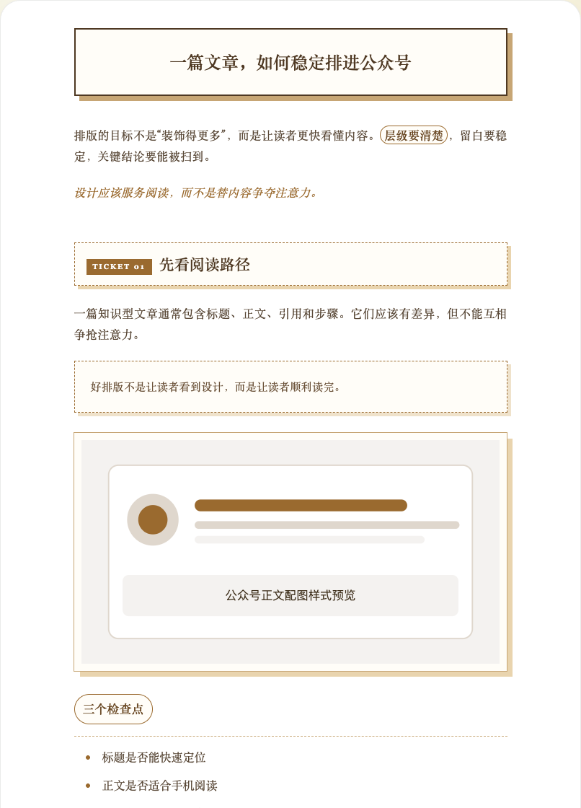
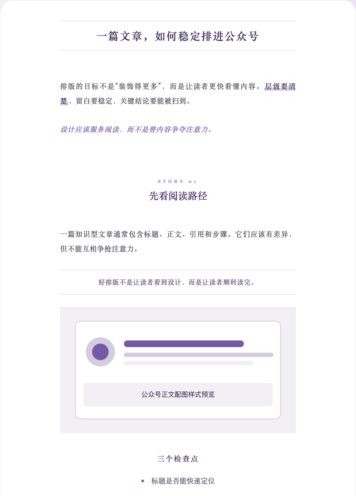
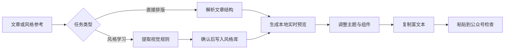

# Zhouxing Paiban WX

一个面向微信公众号文章的排版 Skill：把 Markdown 或已写好的文章生成可编辑的本地实时预览页，在右侧调整主题、组件、字体与间距，确认后复制富文本，直接粘贴到公众号编辑器。

它也支持从排版截图或公众号文章链接中分析视觉规则，经过确认后沉淀为可复用的排版风格。



## 可以做什么

- **文章直接排版**：保持原文和标题层级，生成浏览器可打开的本地预览页面。
- **5 套内置主题**：绿白清简、墨蓝刊读、石墨档案、沙金手记、雾紫叙事。
- **主题联动换色**：修改主题主色后，标题、强调、引用、列表、表格及界面流光同步换色。
- **13 类组件设计**：可分别调整 H1–H6、引用、代码块、行内代码、加粗、斜体、有序列表、无序列表、表格、分隔线、链接和图片。
- **文字与版面控制**：调整字体、字号、字重、段落间距、标题间距和图片上下间距。
- **图片样式**：支持直角、圆角、阴影、描边及组合形式。
- **公众号富文本复制**：复制内联样式，并针对微信中的列表、表格和视觉装饰做兼容处理。
- **风格学习**：分析截图或文章链接的层级、色彩、留白和组件规则，经确认后加入风格库。

## 操作界面

右侧设置栏分为两个主要区域：

1. **排版样式**：选择完整主题并调整主题主色。
2. **排版设计**：在文字设计、样式设计和排版设计之间切换，修改局部组件与间距。

<p align="center">
  
</p>

文章区域可以直接修改。工具栏和页面外壳不会进入复制结果；点击“复制排版”后，只复制文章及其内联样式。

## 内置排版风格

以下截图使用同一篇示例文章，便于对比不同主题的标题构图、正文密度、引用、图片和列表处理。

<table>
  <tr>
    <th>绿白清简</th>
    <th>墨蓝刊读</th>
  </tr>
  <tr>
    <td></td>
    <td></td>
  </tr>
  <tr>
    <th>石墨档案</th>
    <th>沙金手记</th>
  </tr>
  <tr>
    <td></td>
    <td></td>
  </tr>
  <tr>
    <th colspan="2">雾紫叙事</th>
  </tr>
  <tr>
    <td colspan="2" align="center"></td>
  </tr>
</table>

## 安装

### Codex

```bash
git clone https://github.com/Kianzzz/zhouxing-paiban-wx.git
cp -R zhouxing-paiban-wx/zhouxing-paiban-wx ~/.codex/skills/
```

重新启动或刷新 Codex 后，可通过 `$zhouxing-paiban-wx` 调用。

### 其他支持 SKILL.md 的 Agent

把仓库中的 `zhouxing-paiban-wx/` 目录复制到对应产品的 Skills 目录。不同产品的工具权限和本地预览打开方式可能不同，请以实际环境为准。

## 使用示例

直接排版已有文章：

```text
使用 $zhouxing-paiban-wx 帮我排版这篇文章，并打开实时预览页。
```

学习参考风格：

```text
使用 $zhouxing-paiban-wx 分析这张排版截图，先给我风格证据卡，确认后加入风格库。
```

也可以直接运行构建脚本：

```bash
python3 zhouxing-paiban-wx/scripts/build_preview.py \
  --article "/absolute/path/article.md"
```

脚本默认在系统临时目录生成单文件 `index.html`，不会上传文章内容。

## 工作流程



## 兼容性说明

- 本地预览、成功复制、微信编辑器粘贴正常是三个独立验收步骤。
- 微信可能清理外部字体、动画、复杂选择器和部分 CSS；复制结果会转为以内联样式为主的保守结构。
- 列表复制时会转换为普通段落行，减少重复序号、符号与文字错行的问题。
- 表格采用固定列布局和统一单元格盒模型，但仍建议在公众号编辑器中实际粘贴检查。
- 图片上传、防盗链和微信二次处理仍可能改变最终效果。

## 仓库结构

```text
.
├── README.md
├── docs/images/                  # 操作界面与主题截图
└── zhouxing-paiban-wx/
    ├── SKILL.md                  # Skill 入口
    ├── agents/openai.yaml        # Codex 展示信息
    ├── assets/                   # 预览模板、组件库和主题库
    ├── references/               # 兼容、学习与设计规范
    └── scripts/                  # 构建与校验脚本
```

## 参考与说明

组件体系的研究过程参考了 [isjiamu/gzh-design-skill](https://github.com/isjiamu/gzh-design-skill) 的语义化组件组织方法；本仓库使用独立的主题名称、结构、样式声明和操作界面。

项目当前以 macOS + Codex 环境完成主要验证。真实公众号粘贴效果仍应由使用者在微信编辑器中确认。
